### Práctica 5

### Objetivo:

Generar de diferentes formas en un multiplexor ( MUX ) por medio del lenguaje VHDL utilizando el software Quartus II.

### Desarrollo

##### 1 - Generación del proyecto

Creamos un nuevo proyecto con el modelo: **ep4ce22f1ec6** para la Ciclone IV .

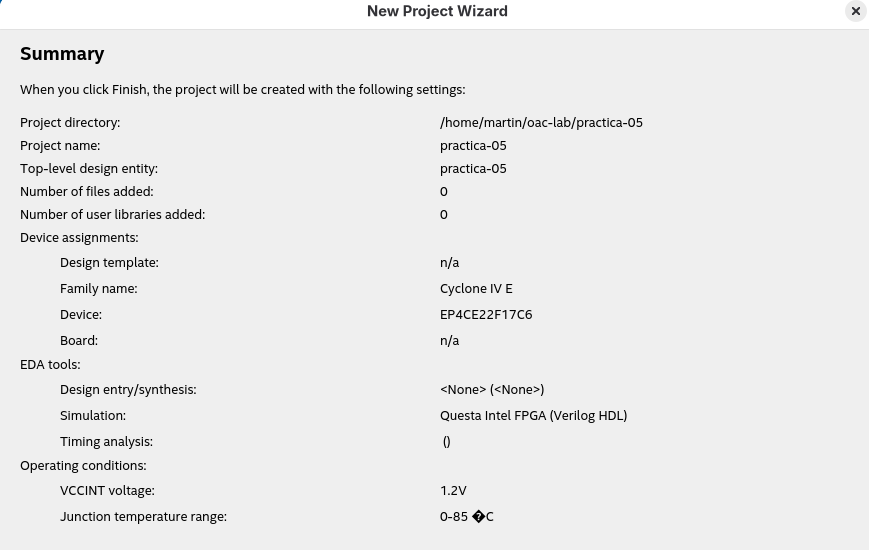

##### 2- Crear el archivo VHDL

En este archivo fuente de VHDL se implementa de diferentes formas el mismo multiplexor.

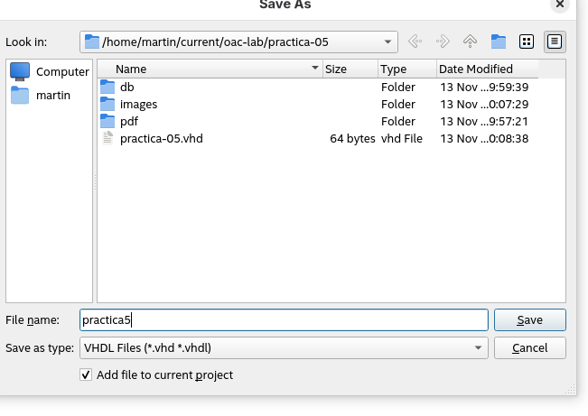

Se ha adecuado el código, con nombres de arquitecturas diferentes, en lugar de comentar y descomentar a la hora de simular

archivo: **practica5.vhd**

```vhdl
library ieee;
use ieee.std_logic_1164.all;
-- Definicion de la identidad
entity practica5 is
	port (
		pto0: in std_logic;
		pto1: in std_logic;
		sel: in std_logic;
		ptops: out std_logic
	);
end practica5;

-- 1. Opcion mediante compuertas
architecture arq_compuertas of practica5 is
begin
	ptops <= ( pto0 and ( not sel ) ) or ( pto1 and sel );
end arq_compuertas;

-- 2. Opcion mediante compuertas, salidas intemedias
architecture arq_senales of practica5 is
signal sig0, sig1: std_logic;
begin
	sig0 <= pto0 and (not sel);
	sig1 <= pto1 and sel;
	ptops <= sig0 or sig1;
end arq_senales;

-- 3. Opcion mediante sentencia recurrente utilizando when
architecture arq_when of practica5 is
begin
	ptops <= pto0 when sel='0' else pto1;
end arq_when;

-- 4. Opcion mediante sentencia recurrente utilizando proceso
architecture arq_proceso of practica5 is
begin
	proceso: process ( sel, pto0, pto1 )
	begin
		if sel = '0' then
			ptops <= pto0;
		else 
			ptops <= pto1;
		end if;
	end process;
end arq_proceso;
```


##### 3 - Compilación del proyecto

Se define practica5.vhd como top level entity se se procede a compilar

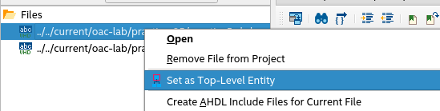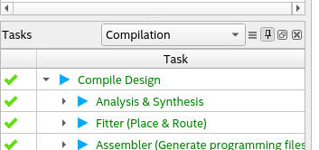


La compilación resulta sin errores. y genera este RTL.

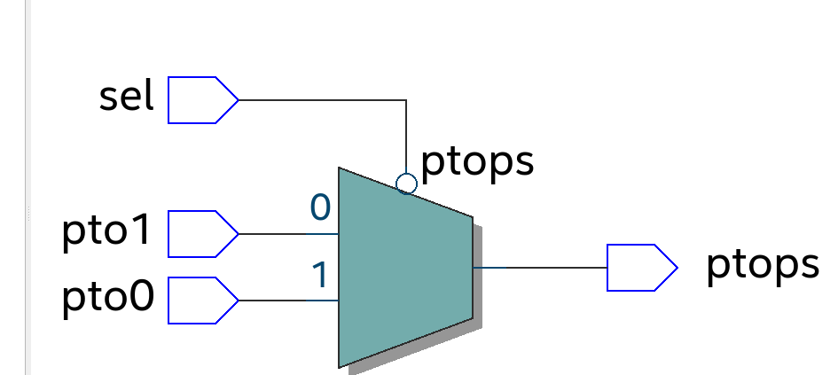


##### 4 - Simulación

Debido a que me encuentro ejecutando una versión 22 de Quartus prime sobre Linux. Ya no está disponible Modelsim.  Mientras que la nueva herramienta de simulación ( Questa ) se maneja mejor con archivos de testbench, de acuerdo con la documentación.

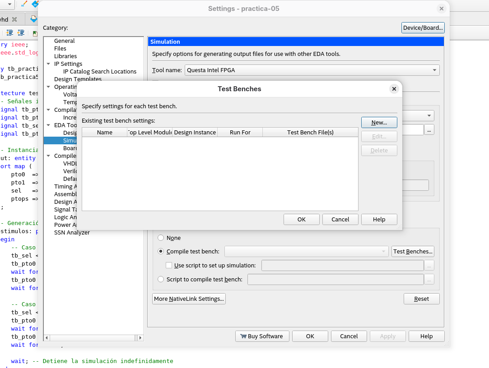

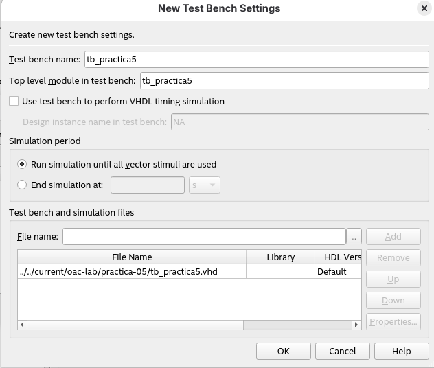


###### Primer simulación [ arq_compuertas ]

Archivo de testbench **tb_practica5.vhd**

```vhdl
library ieee;
use ieee.std_logic_1164.all;

entity tb_practica5 is
end tb_practica5;

architecture test of tb_practica5 is
    -- Señales internas para conectar con el multiplexor
    signal tb_pto0  : std_logic := '0';
    signal tb_pto1  : std_logic := '0';
    signal tb_sel   : std_logic := '0';
    signal tb_ptops : std_logic;
begin
    -- Instancia de la entidad especificando la arquitectura a probar
    uut: entity work.practica5(arq_compuertas)
    port map (
        pto0  => tb_pto0,
        pto1  => tb_pto1,
        sel   => tb_sel,
        ptops => tb_ptops
    );

    -- Generación de estímulos (lo que antes dibujabas en el VWF)
    estimulos: process
    begin
        -- Caso 1: sel = '0', la salida (ptops) debe copiar a pto0
        tb_sel <= '0';
        tb_pto0 <= '1'; tb_pto1 <= '0';
        wait for 10 ns;
        tb_pto0 <= '0'; tb_pto1 <= '1';
        wait for 10 ns;

        -- Caso 2: sel = '1', la salida (ptops) debe copiar a pto1
        tb_sel <= '1';
        tb_pto0 <= '1'; tb_pto1 <= '0';
        wait for 10 ns;
        tb_pto0 <= '0'; tb_pto1 <= '1';
        wait for 10 ns;

        wait; -- Detiene la simulación indefinidamente
    end process;
end test;
```

Resultado de la simulación.

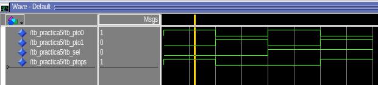

Se observa que cuando **sel** está en cero  la salida es un espejo de **pt0**

Cuando **sel** está en uno, la salida es un espejo de **pt1**

###### Segunda simulación [ arq_senales ]

Ahora modificamos la a línea **15** en el archivo de testbench para usar la arquitectura de señales.

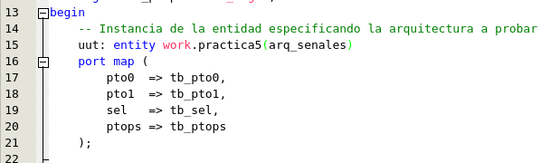

El comportamiento es idéntico, aunque el comportamiento de la entidad de defina de forma diferente

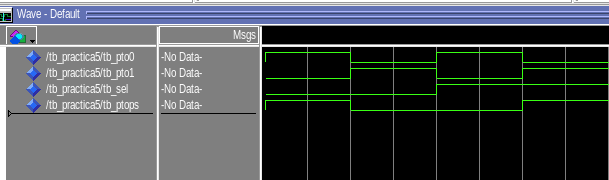

###### Tercera simulación [ aqr_when ]

Ahora probamos la arquitectura definida con when

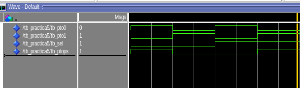

con iguales resultados

###### Cuarta simulación [ arq_proceso ]

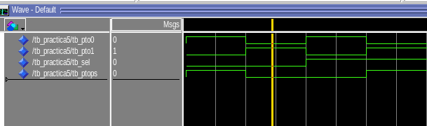

### Conclusiónes

Con esta práctica, en la que implementamos un componente sencillo ( entidad ) con diferentes arquitecturas ( formas de describir ) el mismo comportamiento. Al final el programa logro crear un RTL idéntico para cada una de ellas, claro, por dentro cada arquitectura usará recursos diferentes de la FPGA. Esto demuestra la versatilidad del lenguaje y de las FPGA.
